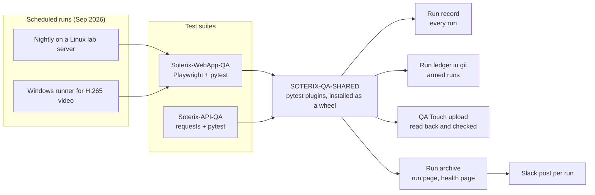

# QA Automation Case Study: Soterix Systems

I was QA Lead at Soterix Systems, a startup selling AI video analytics as a
service: cameras on customer sites, edge boxes with NVIDIA GPUs running the
analytics, and a cloud web app called NexaiQ-Core. Between July 2025 and
September 2026 I built its test automation, from a first Playwright script to
three connected repos: a browser test suite, an API test suite, and a shared pytest pipeline
that records every run, explains its failures and reports the results to the
team's test management tool. I wrote it with AI coding agents, under rules and
checks I set up so that their output had to prove itself.

Soterix has since closed. The repos are kept as they were at the end, with the
few fixes listed at the bottom of this page.

| | |
|---|---|
| Browser tests | 402 Playwright tests across 13 product areas, each mapped to its manual test case |
| API tests | 55 functional tests, a sweep of 101 read endpoints, 17 partner-API tests |
| Framework tests | 475 in the browser repo, 42 in the API repo, 652 test functions in the shared package |
| Test cases | 3,303 test cases in QA Touch, the team's test management tool |
| History | About 900 commits across the three repos, 31 tagged releases of the shared package |
| Stack | Python, pytest, Playwright, requests, GitHub Actions, QA Touch, Jira |

## The three repos

| Repo | What it is | Start with |
|---|---|---|
| [Soterix-WebApp-QA](https://github.com/JustVar/Soterix-WebApp-QA) | Browser tests of the web app. A test does what a user does in Chrome, and a report page says what failed and why. | [the stream guard](https://github.com/JustVar/Soterix-WebApp-QA/blob/main/tests/shared/helpers/stream_health.py), [the convention checker](https://github.com/JustVar/Soterix-WebApp-QA/blob/main/tools/convention_check.py) |
| [Soterix-API-QA](https://github.com/JustVar/Soterix-API-QA) | API tests of the internal and partner APIs, with no browser. | [the login triage](https://github.com/JustVar/Soterix-API-QA/blob/main/api_clients/auth_helper.py), [the endpoint inventory](https://github.com/JustVar/Soterix-API-QA/blob/main/docs/INTERNAL_API_INVENTORY.md) |
| [SOTERIX-QA-SHARED](https://github.com/JustVar/SOTERIX-QA-SHARED) | The pipeline both suites install: run records, report pages, the QA Touch upload, the CI gates. | [the read-back upload](https://github.com/JustVar/SOTERIX-QA-SHARED/blob/main/src/soterix_qa_shared/qatouch/upload.py), [the run page](https://github.com/JustVar/SOTERIX-QA-SHARED/blob/main/src/soterix_qa_shared/reporting/run_page.py) |

## How the pieces fit

Both suites install the shared package as a wheel kept inside each repo, so a
new teammate needs read access to one repo and nothing else. The package hands
each finished run to a list of destinations ("sinks"). Adding a destination,
such as a JUnit file, means adding a class, not changing the reporter.

## What I would point a QA manager at

1. **An upload that does not trust the vendor.** QA Touch answers "success"
   for results it throws away. The uploader reads every result back and
   compares it, and a read-back that cannot run is marked unverified and
   queued for retry, never counted as a pass.
   [upload.py](https://github.com/JustVar/SOTERIX-QA-SHARED/blob/main/src/soterix_qa_shared/qatouch/upload.py)
2. **A report that names causes, not just failures.** The run page opens with
   a one-sentence verdict, groups failures that share one error, labels known
   app defects apart from new ones, and gives each failure its screenshot,
   video and trace.
   [run_page.py](https://github.com/JustVar/SOTERIX-QA-SHARED/blob/main/src/soterix_qa_shared/reporting/run_page.py)
3. **Measuring the environment before blaming the test.** The live-video
   tests need H.265, which Chrome on Linux cannot decode. Before any of them
   runs, the stream guard opens the media socket, counts frames, reads the
   codec and asks this browser whether it can play it. It measures twice
   before skipping, and it refuses headless Chrome on Windows, which claims
   the codec and never decodes a frame.
   [stream_health.py](https://github.com/JustVar/Soterix-WebApp-QA/blob/main/tests/shared/helpers/stream_health.py)
4. **Failing in one line instead of one minute.** A preflight signs in through
   the API before any browser opens and prints one line naming the cause:
   server down, wrong password, or wrong site.
   [preflight.py](https://github.com/JustVar/Soterix-WebApp-QA/blob/main/tests/shared/helpers/preflight.py)
5. **House rules a machine enforces.** A convention checker reads the code
   on every commit and blocks the patterns that caused real defects. Each
   message names the defect behind the rule.
   [convention_check.py](https://github.com/JustVar/Soterix-WebApp-QA/blob/main/tools/convention_check.py)
6. **Test cases that come from the tests.** Each test carries its steps and
   expected result. A tool turns them into QA Touch cases, and an audit
   scores every test against its case and flags weak matches. Every one of the
   402 browser tests is mapped.
   [qatouch_cases_from_tests.py](https://github.com/JustVar/Soterix-WebApp-QA/blob/main/tools/qatouch_cases_from_tests.py),
   [qatouch_mapping_audit.py](https://github.com/JustVar/Soterix-WebApp-QA/blob/main/tools/qatouch_mapping_audit.py)
7. **Credentials that cannot leak into evidence.** A password once reached a
   shared test log through a failing test's printout. Every password is now a
   type that prints `***`, and a scan checks run evidence for leaked values in
   escaped forms too.
   [secret.py](https://github.com/JustVar/Soterix-WebApp-QA/blob/main/config/secret.py),
   [evidence_scan.py](https://github.com/JustVar/Soterix-WebApp-QA/blob/main/tools/evidence_scan.py)
8. **API failures that explain themselves.** A failed login says whether the
   account is unknown, the password is stale or the server is unreachable.
   A failed test carries its HTTP exchanges with secrets masked. Every
   endpoint the sweep skips records where and when the failure was measured.
   [auth_helper.py](https://github.com/JustVar/Soterix-API-QA/blob/main/api_clients/auth_helper.py),
   [endpoints.py](https://github.com/JustVar/Soterix-API-QA/blob/main/tests/internal_api/data/endpoints.py)
9. **Packaging that cannot drift.** CI installs the built wheel and imports
   it, refuses a release tag that differs from the package version, and pins
   every action to a commit. Each test repo has a test that fails when its
   installed version, its requirements line and its wheel disagree.
   [ci.yml](https://github.com/JustVar/SOTERIX-QA-SHARED/blob/main/.github/workflows/ci.yml)

## What the testing found

- An API call that answered `Successfully deleted!` and deleted nothing.
  The defect was confirmed in the UI.
  ([API_SURFACES.md](https://github.com/JustVar/Soterix-API-QA/blob/main/docs/API_SURFACES.md))
- The vendor's OpenAPI spec was missing at least 14 production endpoints, and
  it gives every endpoint the suites call a generic wrapper as its response,
  so it cannot say what an endpoint returns. The 83 internal endpoints the
  suites use are documented from the live system instead, each with the date
  it was last confirmed.
- The first live run of the endpoint sweep failed 30 of 101. The cause was in
  the harness (a channel looked up on the wrong site), not the product. After
  the fix: 120 passed, 47 skipped, 0 failed.
- By late September the nightly ended with about 30 red tests per tenant, most
  of them app defects already reported. A known-defects list labelled 16 of
  those tests (6 defects), so a reader could see the new failures in minutes.

## How I worked with AI coding agents

I wrote this code with AI coding agents (Claude Code, OpenAI Codex and
Microsoft 365 Copilot). The work that mattered was keeping their output honest:

- **Written rules.** Every repo has an
  [AGENTS.md](https://github.com/JustVar/Soterix-WebApp-QA/blob/main/AGENTS.md):
  what to read first, and hard rules such as "read a file fully before you
  edit it" and "propose a large rewrite instead of applying it".
- **Rules a machine enforces.** A rule that depends on memory fails, so the
  important ones are also
  [pre-commit checks](https://github.com/JustVar/Soterix-WebApp-QA/blob/main/tools/hooks/pre-commit)
  and CI steps: no credential in a staged line, the conventions hold, the test
  count did not fall, lint is clean, the offline suites pass.
- **Measure, do not assert.** A number in a doc or a commit has to come from a
  command that was run. A check has to fail when it should, not only pass, and
  that is shown before it is trusted. A test is believed once a deliberate bug
  makes it fail.
- **Adversarial review.** On 1 Sep 2026 I had the pipeline audited across
  seven dimensions (concurrency, multiple environments, network, partial
  outage, data integrity, security, performance): 32 raw findings, 30
  confirmed, each given a disposition. The worst was a trace file that could
  leak session cookies from the evidence archive. It was fixed.
- **A writing standard.** Docs, comments and commit messages follow a short
  style guide with a mechanical check, so the prose stays plain and
  consistent no matter who or what wrote it.

## What ran, and what did not

What ran:

- The browser suite ran every night on a Linux lab server against two tenants.
  The rebuilt nightly first completed on 11 Sep 2026, and each run posted to
  Slack from 25 Sep.
- A Windows machine ran the live-video tests, which need a browser that can
  decode H.265.
- A failure register tracked 135 numbered issues, each with an owner, a status
  and the next action.

What did not:

- Results reached QA Touch only from runs started by hand. The scheduled
  nightly never uploaded.
- Automatic Jira bug filing was built, and never switched on.
- The suite is mostly end-to-end. Backend behaviour such as user directory
  sync, multi-factor sign-in and webhooks belonged in the API suite, and that
  shift had only started.

On 29 Sep 2026 I cut the repos back to one QA server and no schedule, so that
someone else could run them. Everything that
left is kept under the git tag `pre-pivot`, and each repo's ARCHIVE.md lists
what left and how to bring it back.

## What I would do next

- Arm the nightly so QA Touch fills itself, and split each release into an
  automated run and a manual run, so the manual run shrinks every time a test
  is mapped.
- Move backend checks to the API suite, where a test runs in about a second
  against about 13 seconds in the browser.
- Give a teammate ownership of one repo. Most of the framework had one author,
  which was the biggest risk in the program.

## Changes made after the company closed

To make the repos readable from outside, in October 2026:

- The smoke set (`run.py smoke`) selected no tests. It now holds 18 read-only
  tests, one or two per product area, with a check that keeps it that way.
- Ten old test-case snapshots left the main branch (58 MB to 18 MB).
- The API README no longer claims response schema validation, for the reason
  given above.
- Clone links point at these repos, each README opens with a short summary,
  and some dead code left the shared package.

CI is switched off here. It ran on the company's copies of these repos, and
there is no server left to test against. The offline suites still run on any
machine, and each repo's README says how.
