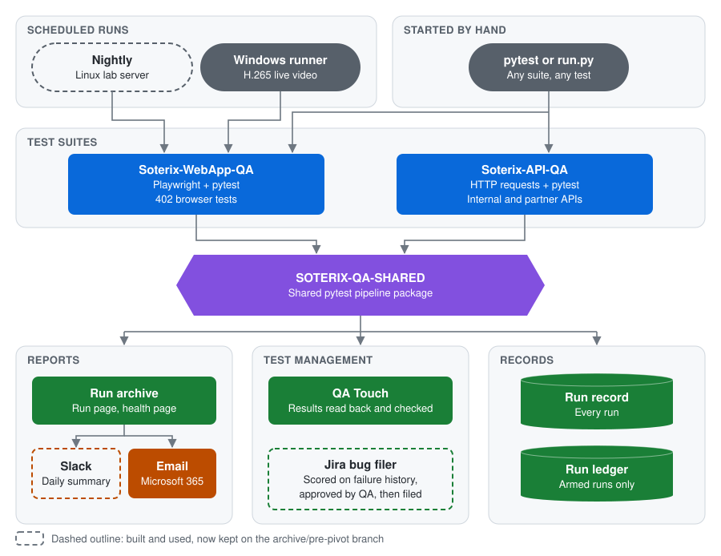
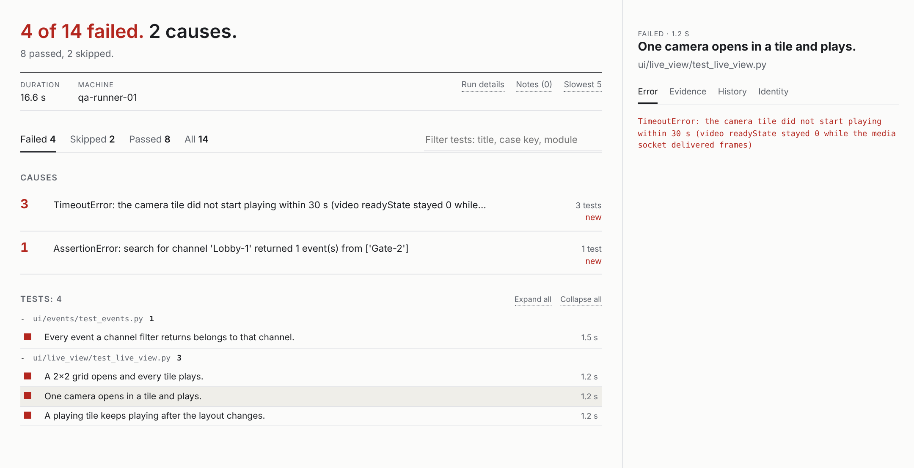

# QA Automation Case Study: Soterix Systems

Justin Varughese, System Platform QA/QC Manager.
[LinkedIn](https://www.linkedin.com/in/justin-var/)

I built this test automation framework for NexaiQ-Core, the cloud web app of
Soterix Systems, while I was its System Platform QA/QC Manager. Soterix sold
AI video analytics as a service. The company has since closed, so the code is
published here for review, and only the offline tests can still run.

The framework is three connected repos: a browser test suite, an API test
suite, and a shared pytest pipeline. The pipeline records every run, explains
its failures, uploads the results to QA Touch and emails reports through
Microsoft 365. QA Touch is a test management tool: it holds a team's test
cases and records the result of each test run, manual or automated. A daily
Slack summary and a Jira bug filer were built alongside it. I built the
framework with AI coding agents, under rules and checks I set up so that their
output had to prove itself.

| | |
|---|---|
| Browser tests | 402 Playwright tests across 13 product areas, each mapped to its test case in QA Touch |
| API tests | 52 functional tests, 17 partner-API tests, and a sweep that calls 101 read-only endpoints and checks that each one answers |
| Hardware tests | 33 tests of the cameras' own web pages and firmware, run on each of 17 lab camera entries (kept on the archive branch) |
| Tests of the tooling itself | 645 in the browser repo, 47 in the API repo, 850 in the shared package, all offline. The pipeline writes to the team's system of record, so it is tested like product code |
| Integrations | QA Touch (test management), Jira (defects), Slack and Microsoft 365 email (reports) |
| Scale | Over 900 commits across three repos, 31 tagged releases of the shared package |
| Stack | Python, pytest, Playwright UI and end-to-end automation with the Page Object Model, REST API testing (requests), CI with GitHub Actions, QA Touch, Jira, Slack, Microsoft 365, AI coding agents (Claude Code, OpenAI Codex, Microsoft 365 Copilot) for agentic development |

## Where to start

1. This page and its diagram.
2. A run report page: the [screenshot below](#a-run-report-page), then
   [run_page.py](https://github.com/JustVar/SOTERIX-QA-SHARED/blob/main/src/soterix_qa_shared/reporting/run_page.py),
   which builds it.
3. One browser test and its page object:
   [test_login_valid.py](https://github.com/JustVar/Soterix-WebApp-QA/blob/main/tests/ui/login/test_login_valid.py),
   [login_page.py](https://github.com/JustVar/Soterix-WebApp-QA/blob/main/tests/shared/pages/login_page.py)
   and the [login folder's README](https://github.com/JustVar/Soterix-WebApp-QA/blob/main/tests/ui/login/README.md).
4. The verified upload:
   [upload.py](https://github.com/JustVar/SOTERIX-QA-SHARED/blob/main/src/soterix_qa_shared/qatouch/upload.py).
5. How the agents were kept honest:
   [AGENTS.md](https://github.com/JustVar/Soterix-WebApp-QA/blob/main/AGENTS.md)
   and the [pre-commit checks](https://github.com/JustVar/Soterix-WebApp-QA/blob/main/tools/hooks/pre-commit).

The [Terms](#terms) section at the end explains the words the repos use.

## The three repos

| Repo | What it is | Start with |
|---|---|---|
| [Soterix-WebApp-QA](https://github.com/JustVar/Soterix-WebApp-QA) | Browser tests of the web app. A test does what a user does in Chrome, and a report page says what failed and why. | [the stream guard](https://github.com/JustVar/Soterix-WebApp-QA/blob/main/tests/shared/helpers/stream_health.py), [the convention checker](https://github.com/JustVar/Soterix-WebApp-QA/blob/main/tools/convention_check.py) |
| [Soterix-API-QA](https://github.com/JustVar/Soterix-API-QA) | API tests of the internal and partner APIs, with no browser. | [the login triage](https://github.com/JustVar/Soterix-API-QA/blob/main/api_clients/auth_helper.py), [the endpoint inventory](https://github.com/JustVar/Soterix-API-QA/blob/main/docs/INTERNAL_API_INVENTORY.md) |
| [SOTERIX-QA-SHARED](https://github.com/JustVar/SOTERIX-QA-SHARED) | The pipeline both suites install: run records, report pages, the QA Touch upload, the CI gates. | [the verified upload](https://github.com/JustVar/SOTERIX-QA-SHARED/blob/main/src/soterix_qa_shared/qatouch/upload.py), [the run report page](https://github.com/JustVar/SOTERIX-QA-SHARED/blob/main/src/soterix_qa_shared/reporting/run_page.py) |

## How it fits together

<picture>
  <source media="(prefers-color-scheme: dark)" srcset="diagram/architecture-dark.svg">
  
</picture>

### What happens in one run

1. A person starts pytest, by hand or with `run.py`, or the Windows runner
   starts the live-video tests on a schedule. A nightly on a Linux lab server
   used to run the browser suite against two test tenants.
2. A browser run first signs in through the API (the preflight check). If the
   server is down or refuses the account, one line says so and no test runs.
   Before the live-video tests, the stream guard checks that this browser can
   play the server's video.
3. The tests run. Two plugins from the shared package watch them: the run
   archive keeps each test's evidence and writes the run page, and the
   reporter records one result per test.
4. The reporter hands the results to its destinations: the run record (every
   run), the run ledger (armed runs only), and, when the upload is
   armed with `--qatouch-upload` and a QA Touch run key, the QA Touch upload,
   which reads every result back and checks it.
5. A person reads the run page: the verdict, the causes, then one test at a
   time. The pipeline can also email the report through Microsoft 365.

On the `archive/pre-pivot` branch, a daily Slack message listed each run's
results and any run that should have happened and did not
([announce_run.py](https://github.com/JustVar/Soterix-WebApp-QA/blob/archive/pre-pivot/tools/announce_run.py)).
A Jira bug filer scored each failure on its history and on the health of the
test environment, queued the bug for a QA engineer to approve, and then filed
it with every required field of the Jira project filled in
([smart_jira_bug_creator.py](https://github.com/JustVar/Soterix-WebApp-QA/blob/archive/pre-pivot/tools/smart_jira_bug_creator.py)).
"Pre-pivot" is the setup before the framework was cut down to one QA server.

Both suites install the shared pipeline as a package kept inside each repo, so
a new engineer needs access to one repo and nothing else. Adding a destination,
such as a JUnit file or a dashboard feed, means a small class and one line
where the destinations are listed; the reporter's hooks stay as they are.

### A run report page

This page comes from a demo run of made-up tests, so it holds no company data.
Three of the four failures share one error, so the page shows 2 causes, not 4
failures. A click on a test opens its error, evidence, history and identity in
the side pane. In a real browser run the evidence tab holds the screenshot,
video and Playwright trace of the failure.

## Engineering highlights

1. **Results that are checked, not trusted.** QA Touch's API answers "success"
   for results it throws away. The uploader reads every result back and
   compares it, and a result it cannot confirm is queued for retry, never
   counted as a pass.
   [upload.py](https://github.com/JustVar/SOTERIX-QA-SHARED/blob/main/src/soterix_qa_shared/qatouch/upload.py)
2. **A report that names causes, not just failures.** The run page opens with
   a one-sentence verdict, groups failures that share one error, labels known
   app defects apart from new ones, and gives each failure its screenshot,
   video and trace.
   [run_page.py](https://github.com/JustVar/SOTERIX-QA-SHARED/blob/main/src/soterix_qa_shared/reporting/run_page.py)
3. **Measuring the environment before blaming the test.** The live-video
   tests need H.265 video, which Chrome on Linux cannot decode. Before any of
   them runs, the stream guard opens the video stream, counts frames, reads
   the codec and asks this browser whether it can play it. When no frames
   arrive, it measures a second time before it skips the tests. It also
   refuses headless Chrome (Chrome with no window) on Windows, which claims
   the codec and never decodes a frame.
   [stream_health.py](https://github.com/JustVar/Soterix-WebApp-QA/blob/main/tests/shared/helpers/stream_health.py)
4. **Failing in one line instead of one minute.** Before any browser opens, a
   preflight check signs in through the API. When the server is down or it
   refuses the account (a wrong password, a locked account), one line names
   the cause and no test runs.
   [preflight.py](https://github.com/JustVar/Soterix-WebApp-QA/blob/main/tests/shared/helpers/preflight.py)
5. **House rules a machine enforces.** A convention checker reads the code on
   every commit and blocks the patterns that caused real defects. Each message
   names the defect behind the rule.
   [convention_check.py](https://github.com/JustVar/Soterix-WebApp-QA/blob/main/tools/convention_check.py)
6. **Test cases that come from the tests.** Most tests (325 of 402) carry
   their steps and expected result. A tool turns them into QA Touch cases, and
   an audit scores every test against its case and flags weak matches. All 402
   browser tests are mapped.
   [qatouch_cases_from_tests.py](https://github.com/JustVar/Soterix-WebApp-QA/blob/main/tools/qatouch_cases_from_tests.py),
   [qatouch_mapping_audit.py](https://github.com/JustVar/Soterix-WebApp-QA/blob/main/tools/qatouch_mapping_audit.py)
7. **Credentials kept out of evidence.** Every password is wrapped in a type
   that shows as `***` in tracebacks, logs and test reports, and a scan tool
   checks a run's evidence for leaked values, including encoded and escaped
   copies, and redacts them. Both were added after a failed login wrote a
   password into a test log that was shared with the team.
   [secret.py](https://github.com/JustVar/Soterix-WebApp-QA/blob/main/config/secret.py),
   [evidence_scan.py](https://github.com/JustVar/Soterix-WebApp-QA/blob/main/tools/evidence_scan.py)
8. **API failures that explain themselves.** A failed login says whether the
   account is unknown, the password is stale or the server is unreachable. A
   failed test carries its HTTP requests and responses with secrets masked.
   Every endpoint the sweep skips records where and when the failure was
   measured.
   [auth_helper.py](https://github.com/JustVar/Soterix-API-QA/blob/main/api_clients/auth_helper.py),
   [endpoints.py](https://github.com/JustVar/Soterix-API-QA/blob/main/tests/internal_api/data/endpoints.py)
9. **Releases that cannot drift.** CI installs the built package and imports
   it, refuses a release tag that differs from the package version, and pins
   each GitHub Action to an exact commit, so a CI step cannot change under it.
   Each test repo has a test that fails when the version it runs differs from
   the version it declares.
   [ci.yml](https://github.com/JustVar/SOTERIX-QA-SHARED/blob/main/.github/workflows/ci.yml)

### Why a custom pipeline

Three reasons. The company preferred in-house tools to paid third-party
services. Building it ourselves meant it fit the team's actual needs, such as
checking every QA Touch result and testing live H.265 video. And because it was
built with AI coding agents, building it in-house let me vet the agents' work
step by step, under the same rules and checks as the tests themselves.

## How I work with AI coding agents

I built this with AI coding agents (Claude Code, OpenAI Codex and Microsoft 365
Copilot), and I was the human in the loop throughout. I set the plan and the
scope, reviewed and fact-checked what the agents produced, and wrote the
documentation from the verified result. I researched industry practice and
the tools' own documentation, so each decision rested on facts. A person, me,
gave the final approval on every change. The practices that kept the agents'
output honest:

- **Written rules.** Every repo has an
  [AGENTS.md](https://github.com/JustVar/Soterix-WebApp-QA/blob/main/AGENTS.md):
  what to read first, and hard rules such as "read a file fully before you
  edit it" and "propose a large rewrite instead of applying it".
- **Rules a machine enforces.** A rule that depends on memory fails, so the
  important ones are also
  [pre-commit checks](https://github.com/JustVar/Soterix-WebApp-QA/blob/main/tools/hooks/pre-commit)
  and CI steps: no credential in a staged line, the conventions hold, the test
  count did not fall, lint is clean, the offline suites pass.
- **Measure, do not assert.** A number in a doc or a commit has to come from a
  command that was run. A check has to be shown failing when it should before
  it is trusted, and a test is believed once a deliberate bug makes it fail.
- **Adversarial review.** Separate AI agents reviewed the pipeline across
  seven dimensions (concurrency, multiple environments, network, partial
  outage, data integrity, security, performance): 32 raw findings, 30
  confirmed. I decided the resolution of each one. The most serious, a trace
  file that could expose session cookies in the evidence archive, was fixed.
- **A writing standard.** Docs, comments and commit messages follow a short
  style guide with a mechanical check, so the prose stays plain and consistent
  whoever or whatever wrote it.

## What this makes possible

What is built supports these next steps directly:

- **A manual regression that shrinks as automation grows.** Because every
  browser test is mapped to its QA Touch case, each release can run as two
  runs: one the pipeline fills, and one for the manual team that holds only
  the cases no test covers yet.
- **Faster, steadier coverage of backend behaviour.** An API test needs no
  browser and runs in a fraction of the time of a browser test, so checks of
  server behaviour can move to the API suite and keep the browser suite for
  what a user sees.
- **New products on the same pipeline.** A new suite, such as the partner
  admin tool or the mobile app, installs the shared package and gets the run
  records, report pages, QA Touch upload and CI gates through a thin setup
  layer, with no new pipeline code.
- **Defects filed from failures, with a person in the loop.** The Jira bug
  filer turns a confirmed failure into a complete bug report once a QA
  engineer approves it.
- **A team that can run it without its author.** A new engineer needs read
  access to one repo, the offline suites run on any machine, and every rule
  is written down with the reason behind it.

## Running the code

The QA server is gone, so the browser and API suites have nothing to run
against. Each repo's offline suites still run on any machine, and each
README's first section says how. CI ran on the company's copies of these repos
and is switched off here. The nightly, the published run archive, the Slack
summary and the camera tests are kept on the `archive/pre-pivot` branch, and
the ARCHIVE.md in each test repo lists what is there.

## Terms

| Term | Meaning |
|---|---|
| Tenant | One customer account on the QA server. The nightly tested two. |
| Preflight | The sign-in check a browser run makes through the API before any browser opens. |
| Stream guard | The check that this browser can play the server's live video before the live-video tests run. |
| H.265 | The video format the cameras streamed. Chrome on Linux cannot decode it; Chrome on Windows can. |
| Headless | A browser run with no window. Faster, but on Windows it claims H.265 and plays nothing. |
| Sweep | One API test run once per endpoint: it calls each of 101 read-only endpoints and checks the answer. |
| Run archive | The folder of one run's evidence, with its run page (`run.html`) and an index of all runs. |
| Run record | The JSON file of the latest run's results that the repo's tools read. |
| Run ledger | One line per armed run in `history/`, so results stay comparable over time. The nightly committed it to git. |
| Armed | A run set to upload: `--qatouch-upload` and a QA Touch run key. Without both, nothing goes to QA Touch. |
| Destination (sink) | Where the reporter sends a finished run: the run record, the ledger or the QA Touch upload. The code calls it a sink. |
| Case key | The ID of a test case in QA Touch. `config/qatouch_case_mapping.json` maps each test to one. |
| Vendored wheel | The built shared package, kept in each test repo's `vendor/` folder, so installing needs no other repo. |
| Shim | A small module in a test repo that points an old import path at the shared package. |
| Gate | A check that fails a commit or a run, such as the collected-test floor: a suite may not collect fewer tests than before. |
| Archive branch | `archive/pre-pivot`: the last state before the framework was cut down to one QA server. |

## Contact

Justin Varughese, [LinkedIn](https://www.linkedin.com/in/justin-var/)
